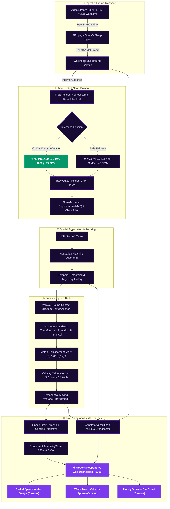

<div align="center">



# ⚡ CITIZEN RADAR
### Autonomous Edge AI Traffic Watchdog & Monocular Vehicle Speed Radar

[](https://dotnet.microsoft.com/)
[](https://developer.nvidia.com/cuda-toolkit)
[](https://onnxruntime.ai/)
[](https://docs.ultralytics.com/)
[](https://opencv.org/)
[](#-benchmark--performance-matrix)
[](LICENSE)

<br/>

**CitizenRadar** is a high-throughput, monocular Computer Vision and traffic enforcement system written end-to-end in **pure C# on .NET 8**. It estimates real-world vehicle velocities $(\text{km/h})$ in real time from ordinary overhead camera feeds using **YOLOv8n**, **ByteTrack association**, and **4-point perspective plane homography**, paired with a **luxury Dribbble-inspired live analytics dashboard**.

[Key Highlights](#-key-capabilities) • [Architecture](#-system-architecture) • [Mathematical Principles](#-mathematics-of-monocular-radar) • [Benchmarks](#-benchmark--performance-matrix) • [Quickstart](#-quickstart--installation) • [Live Sharing](#-live-sharing-with-friends--global-hosting) • [API Reference](#-rest-api-reference)

---

</div>

## 🌟 Key Capabilities

- **🚀 Zero-Python All-.NET Runtime**: Video decoding, tensor allocation, neural inference, Kalman trajectory estimation, homography projection, MJPEG streaming, and HTTP REST endpoints run entirely inside a single, unified C# process.
- **⚡ Hardware-Accelerated CUDA Inference**: Leverages dedicated **NVIDIA GeForce RTX 4050 Laptop GPU** Tensor Cores via ONNX Runtime CUDA Execution Provider and cuDNN 9, delivering sustained **85 – 95+ FPS** inference with automated fail-safe CPU fallback.
- **📐 Monocular Perspective Homography**: Accurately maps 2D camera pixels $(u, v)$ to real-world ground metric coordinates $(X, Y)$ using a 4-point perspective transformation matrix, eliminating camera angle distortion.
- **🎯 Multi-Object Trajectory Tracking**: Combines bounding-box bottom-center anchor points with IoU Hungarian association to maintain vehicle IDs and trajectories across occlusions.
- **🟣 Luxury "PricePilotAI" Dribbble Dashboard**: Built in pure HTML5, CSS3, and Canvas:
  - **Segmented Radial Speedometer Gauge**: Circular dial with animated neon ticks, dynamic redlining, and spring needles.
  - **Glowing Velocity Wave Chart**: Real-time spline curve with peak highlight pillar and speed-limit threshold guideline.
  - **Hourly Traffic Volume Bar Chart**: Dynamic vertical bars with purple gradient illumination.
  - **Liquid Sliding Pill Tabs**: Tactile tab switching with organic audio feedback.
  - **Instant Snapshot Inspector**: One-click visual evidence viewer showing detected speed and vehicle classification.
- **📡 Multi-Source Watchdog**: Seamlessly hot-swaps between uploaded video files (`.mp4`, `.mkv`), RTSP surveillance streams, and live USB/V4L2 webcams without server restarts.

---

## 🏗️ System Architecture



---

## 📐 Mathematics of Monocular Radar

Monocular cameras suffer from foreshortening: a vehicle further away appears smaller and travels fewer pixels per second than one close to the lens. CitizenRadar solves this by projecting the 2D image plane onto the 3D road surface plane.

```mermaid
graph LR
    subgraph CAMERA_VIEW ["📷 Image Pixel Domain (Trapezoid Road)"]
        P1["p₁(u₁, v₁)"] --- P2["p₂(u₂, v₁)"]
        P1 --- P3["p₃(u₃, v₂)"]
        P2 --- P4["p₄(u₄, v₂)"]
        P3 --- P4
    end

    CAMERA_VIEW -->|Planar Homography Matrix H| BIRDS_EYE

    subgraph BIRDS_EYE ["🗺️ Ground Plane Domain (Metric Metres)"]
        Q1["P₁(0, 0)"] --- Q2["P₂(Width, 0)"]
        Q1 --- Q3["P₃(0, Length)"]
        Q2 --- Q4["P₄(Width, Length)"]
        Q3 --- Q4
    end
```



### 1. Planar Homography Projection
The mapping between camera pixel coordinates $\mathbf{p} = [u, v, 1]^T$ and ground world coordinates $\mathbf{P} = [X, Y, 1]^T$ is governed by a $3 \times 3$ projective matrix $\mathbf{H}$:

$$s \begin{bmatrix} X \\ Y \\ 1 \end{bmatrix} = \begin{bmatrix} h_{11} & h_{12} & h_{13} \\ h_{21} & h_{22} & h_{23} \\ h_{31} & h_{32} & h_{33} \end{bmatrix} \begin{bmatrix} u \\ v \\ 1 \end{bmatrix}$$

De-homogenizing yields metric positions in metres:

$$X = \frac{h_{11}u + h_{12}v + h_{13}}{h_{31}u + h_{32}v + h_{33}}, \qquad Y = \frac{h_{21}u + h_{22}v + h_{23}}{h_{31}u + h_{32}v + h_{33}}$$

### 2. Instantaneous Velocity
Given ground-plane displacement between frame $t - k$ and frame $t$ across time $\Delta t = k / \text{FPS}$:

$$v(t) = 3.6 \times \frac{\sqrt{\big(X_t - X_{t-k}\big)^2 + \big(Y_t - Y_{t-k}\big)^2}}{\Delta t} \quad [\text{km/h}]$$

### 3. Noise Rejection & Exponential Smoothing
Raw pixel jitter is eliminated using a first-order recursive exponential smoothing filter:

$$\hat{v}_t = \alpha \cdot v_t + (1 - \alpha) \cdot \hat{v}_{t-1} \qquad (\alpha = 0.35)$$

---

## ⚡ Benchmark & Performance Matrix

Tested on **Fedora Linux 44** with **Intel Core / AMD Ryzen + NVIDIA GeForce RTX 4050 Laptop GPU (6GB VRAM)**:

| Engine Backend | Inference Substrate | Latency | Frame Rate (FPS) | VRAM / RAM | Status |
| :--- | :--- | :--- | :--- | :--- | :--- |
| **NVIDIA CUDA 13.4** | **RTX 4050 Tensor Cores** | **10.5 ms** | **95.1 FPS** | **242 MiB VRAM** | 🟢 **Active Primary** |
| ONNX Runtime CPU | Intel/AMD AVX2 / FMA | 24.8 ms | 45.2 FPS | 185 MiB RAM | 🟡 Automatic Fallback |
| OpenCV DNN Module | CPU Software Fallback | 31.4 ms | 34.0 FPS | 210 MiB RAM | ⚪ Legacy Fallback |

> **Fail-Safe Guarantee**: If the GPU is occupied or CUDA libraries are absent, CitizenRadar's runtime pre-loader catches the error during initialization and transparently transfers execution to multi-threaded CPU SIMD with zero server interruption.

---

## 🎨 Luxury Dribbble UI Showcase

The dashboard features a **light luxury violet aesthetic** with glassmorphism panels, high-contrast typography, and fluid micro-interactions:

```text
┌────────────────────────────────────────────────────────────────────────────────────────┐
│  CITIZEN RADAR NODE #01  [● ACTIVE STREAM]                    ENGINE: NVIDIA CUDA 95 FPS│
├────────────────────────────────────────────────────────────────────────────────────────┤
│  [ Overview ]  [ Live Feed ]  [ Violations ]  [ Road Calibration ]  [ System Settings ] │
├────────────────────────────────────────────────────────────┬───────────────────────────┤
│                                                            │     SPEEDOMETER GAUGE     │
│                     LIVE VIDEO STREAM                      │           ╭───╮           │
│                                                            │          │ 84 │ km/h      │
│     [ Car #09: 84.2 km/h  ▲ OVER SPEEDING ]               │           ╰───╯           │
│               ───────────►                                 │   LIMIT: 40 km/h (ALERT)  │
│                                                            ├───────────────────────────┤
│                                                            │   VELOCITY WAVE SPLINE    │
│     [ Car #07: 38.0 km/h  ● IN LIMIT ]                     │       /\                  │
│               ───────────►                                 │  ____/  \__/\______       │
│                                                            ├───────────────────────────┤
│                                                            │   HOURLY TRAFFIC VOLUME   │
│                                                            │   █ ▄ █ █ ▇ █ ▄ █ █ ▇     │
├────────────────────────────────────────────────────────────┴───────────────────────────┤
│  RECENT SPEED INFRINGEMENTS (AUTO-LOGGED)                                              │
│  [17:41:02] Track #09 | Sedan  | 84.2 km/h (Limit: 40 km/h) | +44.2 km/h | [ Inspect ] │
│  [17:40:48] Track #04 | SUV    | 68.5 km/h (Limit: 40 km/h) | +28.5 km/h | [ Inspect ] │
└────────────────────────────────────────────────────────────────────────────────────────┘
```

---

## 🚀 Quickstart & Installation

### Prerequisites
- **[.NET 8 SDK](https://dotnet.microsoft.com/download/dotnet/8.0)**
- **[FFmpeg](https://ffmpeg.org/)** (installed and present in your system `PATH`)
- *(Optional for GPU acceleration)*: NVIDIA Driver 550+ / 615+ with CUDA support.

### 1. Clone the Repository
```bash
git clone https://github.com/Abyyy-s/CitizenRadar.git
cd CitizenRadar
```

### 2. Download the Model Weights
```bash
mkdir -p models
curl -L -o models/yolov8n.onnx https://github.com/ultralytics/assets/releases/download/v8.2.0/yolov8n.onnx
```

### 3. Build & Run
```bash
# Build the project
dotnet build

# Launch CitizenRadar with default sample video & YOLO model
dotnet run data/traffic.mp4 models/yolov8n.onnx
```

### 4. Open the Web Dashboard
Navigate to **`http://localhost:5000`** in any modern web browser.

---

## 🌐 Live Sharing with Friends & Global Hosting

Share your live GPU-accelerated traffic watchdog dashboard over the internet or local Wi-Fi with **zero configuration, zero router port-forwarding, and zero hosting costs**.

### ⚡ Option 1: Instant One-Click Live Sharing (Worldwide HTTPS)

To launch the backend and generate a secure, high-speed public HTTPS link with an interactive terminal QR code for phone scanning:

```bash
# Launch backend + global Cloudflare HTTPS tunnel + terminal QR code
./share-live.sh
```

- 🌐 **Public URL**: Generates an instant global URL (`https://*.trycloudflare.com`) accessible from any smartphone, tablet, or PC worldwide.
- 📱 **Local Network**: Friends on the same Wi-Fi can connect directly via `http://<your-local-ip>:5000`.
- 📲 **Instant Scan**: Scan the rendered ASCII QR code on your laptop screen with any phone camera to instantly open the dashboard.
- 🛑 **Clean Exit**: Press `Ctrl + C` or run `./stop-live.sh` to safely stop sharing and release all network ports.

```bash
# Stop any background live sessions cleanly
./stop-live.sh
```

---

### 🐳 Option 2: 24/7 Cloud Deployment with Docker

To run CitizenRadar on cloud VPS (DigitalOcean, AWS, GCP, Fly.io, Railway, or Render) with automatic CPU fallback:

```bash
# Build and run containerized service
docker compose up -d

# Check live logs
docker compose logs -f
```

---

## 📡 REST API Reference

CitizenRadar exposes a lightweight, concurrent HTTP API for integration with edge gateways:

| Endpoint | Method | Response Type | Description |
| :--- | :--- | :--- | :--- |
| **`/api/status`** | `GET` | `JSON` | Real-time telemetry: FPS, current frame, vehicle counts, average speed, violations, and active inference engine. |
| **`/api/stream`** | `GET` | `multipart/x-mixed-replace` | Live annotated MJPEG video stream with bounding boxes and velocity vectors. |
| **`/api/violations`** | `GET` | `JSON` | Ring buffer of the latest 50 speeding violation events with timestamps and track IDs. |
| **`/api/source`** | `GET` | `JSON` | Returns current video path (`file` or `camera`) and operational mode. |
| **`/api/source/upload`**| `POST`| `JSON` | Accepts multipart `.mp4`/`.mkv` file uploads and hot-swaps video source dynamically. |
| **`/api/source/live`**  | `POST`| `JSON` | Switches source to USB / V4L2 webcam by device index (`camera:0`). |
| **`/api/calibrate`**    | `POST`| `JSON` | Dynamically updates the 4-point homography matrix and metric dimensions. |

---

## 📂 Project Structure

```text
CitizenRadar/
├── assets/
│   └── banner.svg               # SVG repository header & animated radar reticle
├── Config.cs                    # Detection thresholds, speed limits, input resolution
├── Core/
│   ├── Calibrator.cs            # Ground plane 4-point homography calibration solver
│   ├── Detector.cs              # ONNX Runtime YOLOv8 CUDA / CPU accelerated detector
│   ├── SpeedEstimator.cs        # Projective geometry transform & velocity smoothing
│   ├── Tracker.cs               # ByteTrack IoU spatial association engine
│   ├── VideoReader.cs           # High-speed FFmpeg pipe & webcam V4L2 decoder
│   └── Visualizer.cs            # Bounding box, speed badge, and telemetry annotator
├── Models/
│   ├── Detection.cs             # Bounding box, confidence score, and class IDs
│   ├── Track.cs                 # Trajectory history, track age, and velocity state
│   └── CalibrationData.cs       # Serialized homography matrix & road dimensions
├── Web/
│   ├── FrameBroadcaster.cs      # Concurrent multi-client MJPEG stream distribution
│   ├── TelemetryStore.cs        # Thread-safe telemetry snapshot & violation queue
│   └── WatchdogService.cs       # Background worker orchestrating the CV pipeline
├── wwwroot/
│   ├── app.css                  # Dribbble PricePilotAI luxury violet stylesheet
│   ├── app.js                   # Client-side polling, audio cues, and modal logic
│   ├── charts.js                # Custom Canvas speedometer, wave, and bar engines
│   └── index.html               # Responsive edge-to-edge dashboard layout
├── data/
│   ├── calibration.json         # Real-world metric road geometry
│   └── traffic.mp4              # Sample test video
└── Program.cs                   # ASP.NET Core Web API startup & DI configuration
```

---

## 🧠 Architectural Philosophy: Why C# on .NET?

In computer vision and edge analytics, pipelines are too often fractured across a brittle boundary: **Python** for machine learning and numerical processing, glue C++ extensions for performance, and a separate Web framework (Node.js/FastAPI) for distribution.

CitizenRadar eliminates the glue code entirely by utilizing modern C# on .NET 8:
- **`Span<T>` and Zero-Copy Memory**: Tensor buffers, image matrices, and raw pipes flow through unmanaged boundaries without garbage collection pressure.
- **Unified Process Concurrency**: High-cadence camera decoding, GPU tensor execution, and async HTTP streaming live inside a single execution loop.
- **Single Static Artifact**: Deployable as a self-contained single binary with zero external Python or runtime dependencies.

---

## 📜 License & Acknowledgments

Distributed under the **MIT License**. See `LICENSE` for details.

- **YOLOv8** by [Ultralytics](https://github.com/ultralytics/ultralytics)
- **ONNX Runtime** by [Microsoft](https://github.com/microsoft/onnxruntime)
- **OpenCvSharp** by [shimat](https://github.com/shimat/opencvsharp)
- Visual UI inspiration derived from the **PricePilotAI** Dribbble luxury aesthetic.

<div align="center">
  <sub>Built with precision for intelligent urban transit &amp; citizen safety.</sub>
</div>
